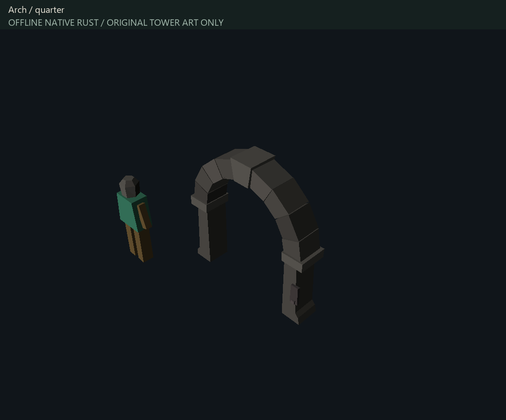
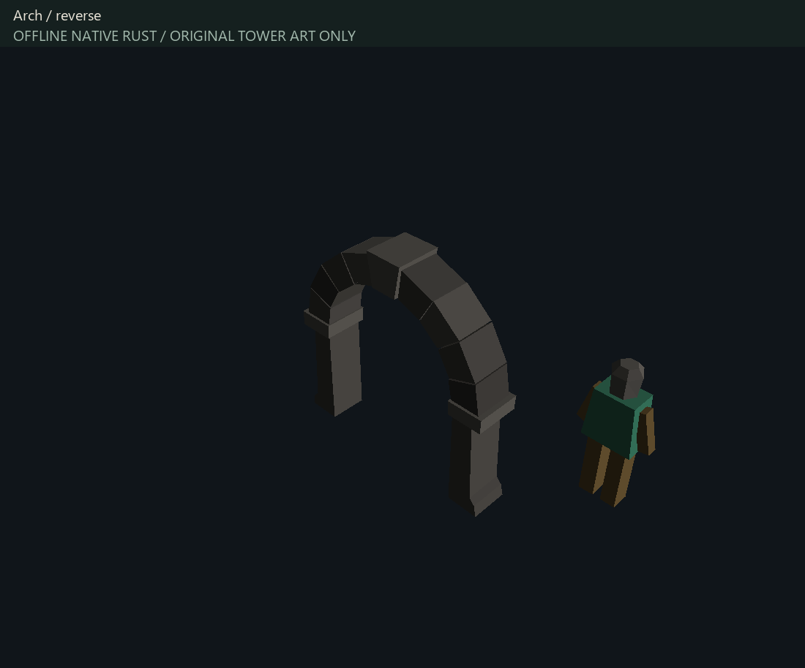
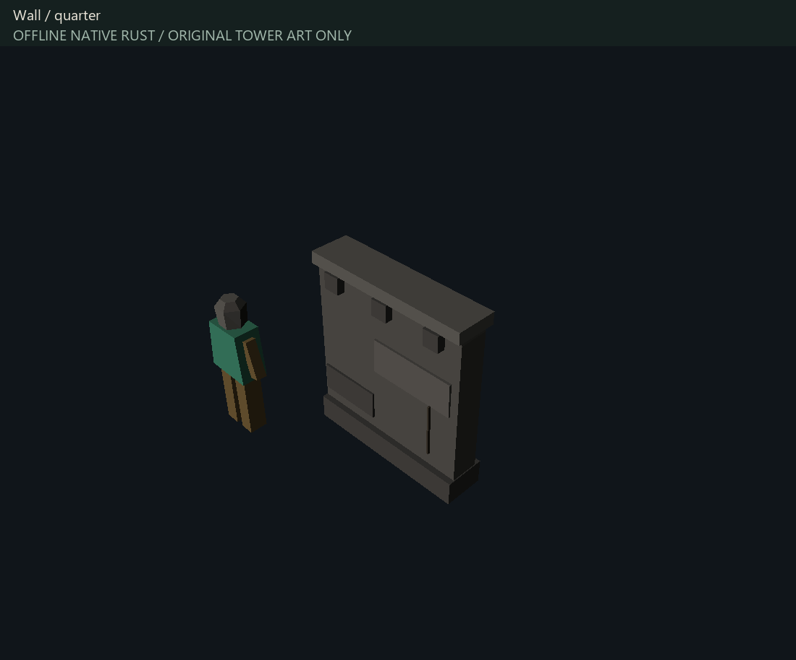
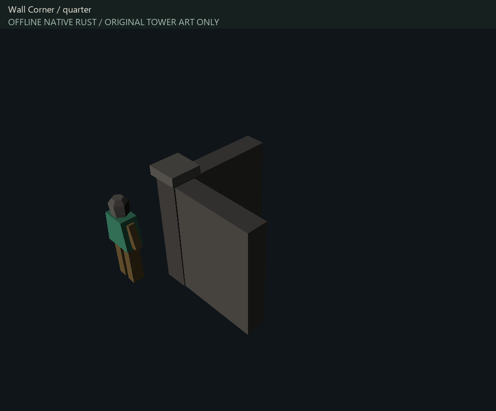
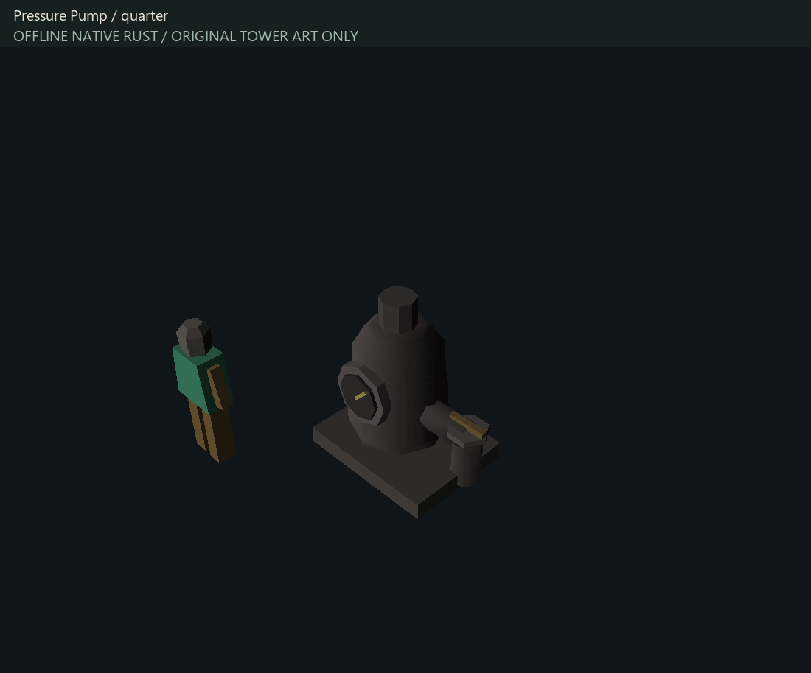
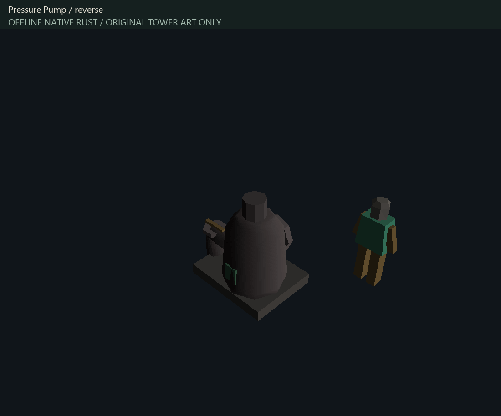

# Stage C — original asset calibration checkpoint

Working direction for user review; not artistically approved. The complete floor rebuild remains in progress.

Thirty authentic references were decoded, measured, viewed in native Rust and imported headlessly into Blender with exact topology/coordinate checks. Source-safe identifiers and measurements are in ../REFERENCE_MANIFEST.json. Extracted meshes, textures, Blender reference projects and mixed comparison frames remain local.

Two original calibration iterations were generated and rendered. Version 2 reduces the crown/jamb mass and warmth found excessive in version 1. The arch is now about 2.56 tiles wide and 2.54 high; ordinary doors and workshop furniture will remain distinctly smaller than the final foundry. The wall replaces five separate beveled courses with a continuous body and finished coping; a separate bonded corner provides termination. The industrial fixture introduces a compact vessel, gauge, outlet and operating side. Native smooth/flat face choice is explicit in source materials and validated after encoding.

Validation: 5 original models, 724 unique triangles, deterministic strict conversion, every native vertex/index/color and shading type checked. All 24 comparison/original-only frames completed. The reference and custom assets within each mixed scene share scale, palette brightness 0.8, scene lighting, target and camera; their perspective depths differ, so pixel sizes are not interchangeable measurements. Published close views use separate framing and contain original Tower art only. A static 1.72-tile figure is a ruler convention, not an authentic NPC/player measurement.

Remaining artistic work: room context, wear tied to use, wall-end detailing, more convincing small tools and layered machinery, ground/rock integration. This checkpoint is not a claim that the wider kit or floor is complete. Normal gameplay rendering, cache contents, production Tower maps and ORACLE parity branch are unchanged.

Reproduce using tools/tower/custom-assets/blender/create_calibrated_kit.py, converter/package_cinderworks.py and design/render_calibration.py. Exact authoring sources and the editable Blender library remain local and are regenerated by the committed script. Stable IDs are in registry.txt; mixed references require authorized revision 239.1 resources and the explicit offline legacy reader. See ../REFERENCE_PIPELINE.md for setup.

