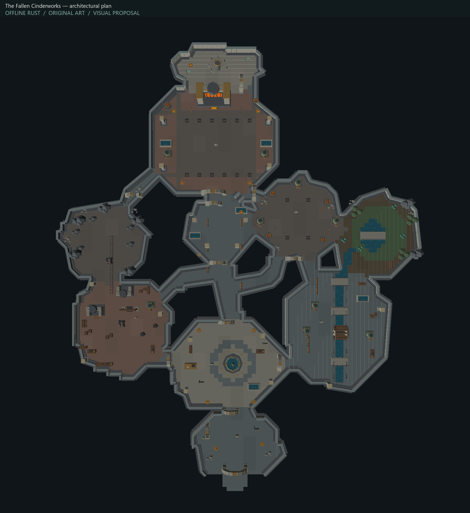
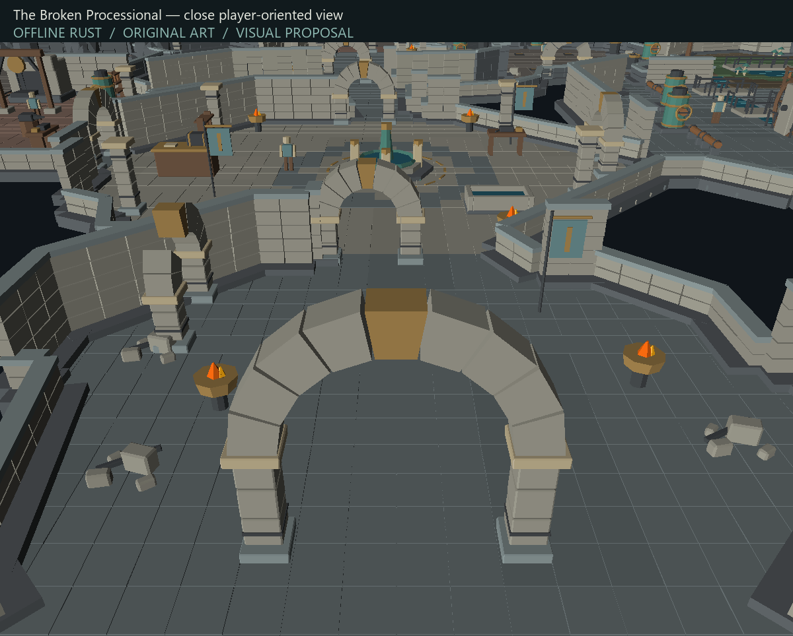
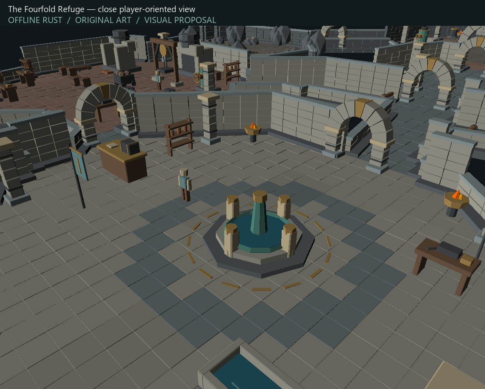
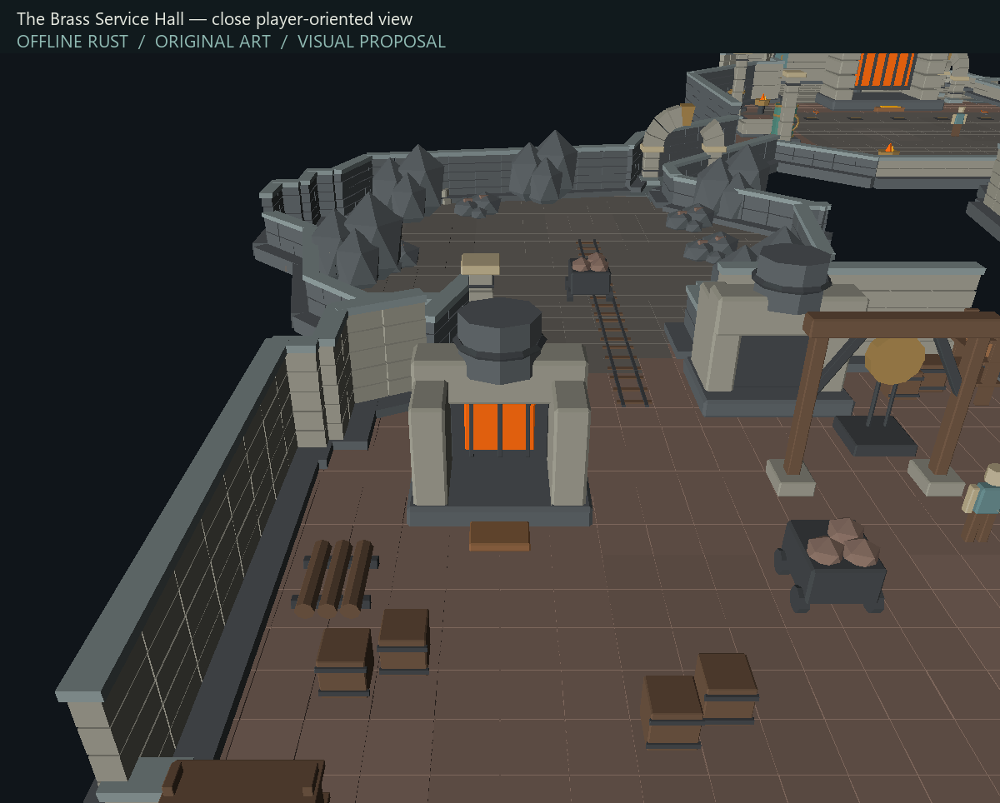
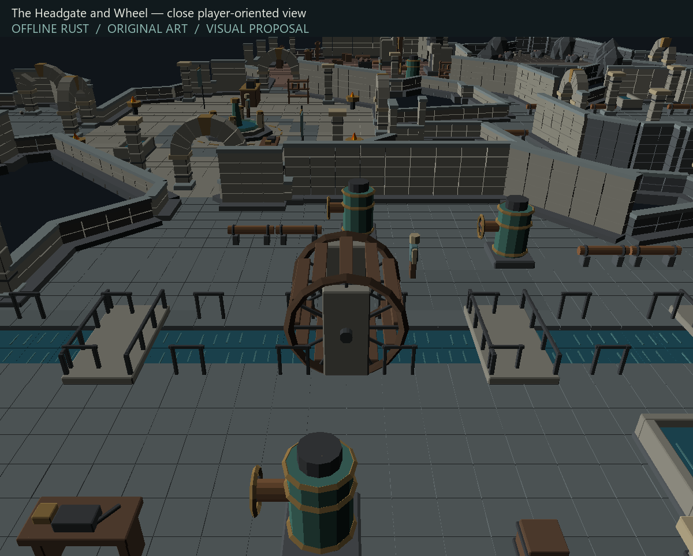
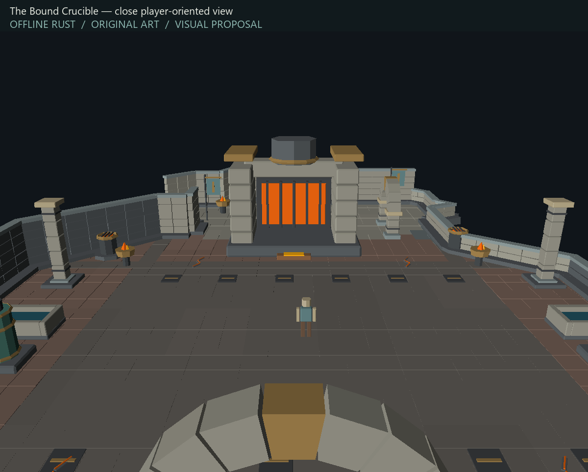

# Preserved generic-kit concept checkpoint

Status: superseded visual study; not artistically approved; no production integration.

This checkpoint preserves the complete 68-model generator, native conversion rules, connected floor composition and review renderer before reference-driven redesign. The full local source, editable Blender library, GLBs, package, 101 raw Rust frames and hashes remain under `experiments/custom-model-pipeline/fallen-cinderworks/{generated-final,package-final,review-final}`. The public images here contain original art only.

Verified baseline: local and remote `agent5/tower-development` both `f9e4433f2451235805f85fe379d351d095b7535b`. Isolated server predecessor `bdc50f1eee0ecbdce380855e08b554ceb99b2b30`; client predecessor `7b52f89be35c8bcd9c9c4c0fc54f735e9a128762`. These experiments are not merged into either production checkout.

Reproduce with Blender 5.2.2 LTS: run `tools/tower/custom-assets/blender/create_cinderworks_kit.py` headlessly with `--output generated`, compose once with `design/compose_floor.py PACKAGE REVIEW`, rerun generator with `--layout REVIEW/design-manifest.json`, then `converter/package_cinderworks.py GENERATED PACKAGE`, recompose and use `design/render_review.py RENDERER PACKAGE SCENE REVIEW --catalogue`. Use sibling experiment client with package-only constructor. See manifests for exact IDs and geometry. Custom models 1100000–1100067; objects 63000–63067. No cache art is part of this checkpoint.

Validation: strict conversion of all 68 assets; 42,636 unique model triangles; native roundtrip verified every vertex/index/color; package-only reopening and cache fallback rejection verified. All 101 native Rust offline frames completed. Floor planning connectivity is not gameplay collision acceptance. All definitions intentionally nonblocking for offline review; curtain sectors require collision partitioning before future integration. No artistic approval is implied.

Known visual faults motivating redesign: repeated rectangular masonry, overly regular paving, simplified industrial props, weak signs of habitation and overly mechanical composition.

