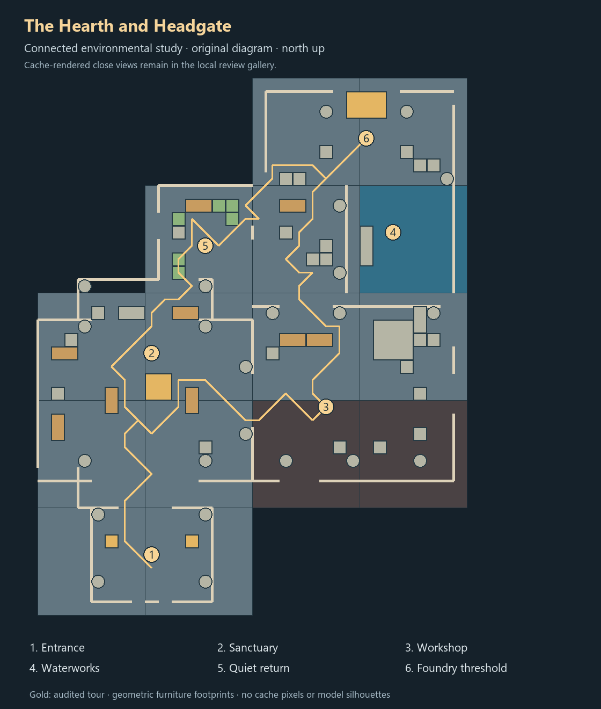
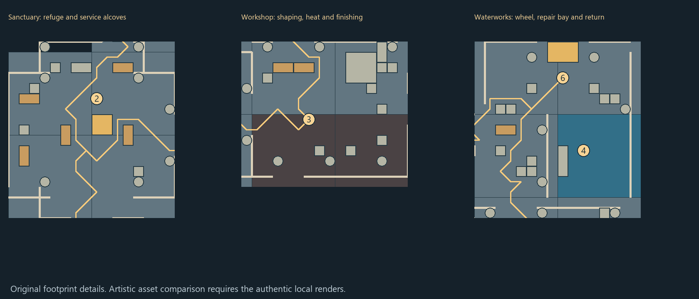

# The Hearth and Headgate

**Developed environmental sequence · visual quality review pending · no production integration.**

The user declined to approve A, B or C as a final map. All three remain unchanged [concept studies](../floor-one/CURRENT_REVIEW.md). This study develops their useful ideas into one connected entrance, sanctuary, workshop and waterworks sequence. It is a quality sample, not another complete-floor option or an approved hybrid map.

## Review the environment

The authentic local gallery is `work/environment-quality-study/review-ready/gallery.html` in the Tower workspace. It contains **12 close player-oriented views and three overview/plan views**, five matched views for each of two alternative architectural treatments, 25 real-cache asset/material comparison boards, a four-angle wheel camera study and a native lighting comparison. Every main close-view target is a reachable standing tile. These are offline compositions using the unchanged native library, not running-player captures.

Start with Entrance → Sanctuary arrival → Sanctuary services → Workshop arrival → Workshop bench → Workshop/water link → Waterworks maintenance → Quiet return → Foundry reveal. Use the overview to understand the loop, then compare close views at full resolution. The preferred study treatment is dressed masonry; the comparison controls retain plain and city-wall treatments as rejected alternatives, not additional map proposals.

Authentic cache imagery remains local: no redistribution permission was established in the previous review. Public PNGs are original geometric drawings, not substitute screenshots or proof of asset-level art quality. Reproducible composition and comparison-scene sources, camera metadata, hashes, decisions and limitations are published here. No cache archives, model/texture files, accounts or private fixtures are included.

## Design intent

- **Entrance:** compress the approach between paired masonry bays and warm iron braziers; reveal the communal hearth beyond the next threshold.
- **Sanctuary:** stepped service alcoves, inward-facing hearth seating, one founder monument and a consistent dressed-stone/pier rhythm. Bank, prayer and provisions belong to the edges rather than filling the central route.
- **Workshop:** a charcoal shaping strip and stone furnace-service apron, timber tool benches, paired anvils, visible fuel/delivery storage, a furnace and bellows. Work clusters describe shaping, heating and finishing while leaving the middle aisle clear.
- **Waterworks:** a compact lined basin, a wheel between structural piers, handpump and cooling vessels, a repair bench and spare wheel. The quiet return passes a localized repair scar and ferns rather than an undifferentiated green room.
- **Forward progression:** the northern turn frames one foundry firebox between two piers and braziers. It is a destination cue; no boss room or encounter has been redesigned.

## What is proved, and what remains open

The study is reproducible and statically connected. Its final audit reports 960 loaded tiles, 802 reached dry tiles, 64 real blocked water tiles and zero issues. It checks service approaches, the four fishing reserves, the tour and all twelve close-view standing positions. There are **zero encounter escape cases** in this study because no arenas were authored or changed. This must not inherit the earlier concepts' hazard acceptance claim.

The visual bar is still the user's decision. In particular, review the court's remaining open space, workshop surface treatment, the basin's sloping cache-height seams and how much architectural enclosure is desirable. The look-at camera, lighting assembly and absent actors/UI differ from live play. No assertion of Jagex-quality approval, playtime, gameplay correctness or restoration-state parity is made.

[Art direction and remaining decisions](ART_DIRECTION.md) · [Asset and treatment decisions](ASSET_DECISIONS.md) · [Evidence and reproduction](EVIDENCE.md) · [Exact manifest](REVIEW_MANIFEST.json)

Extension across the whole floor waits for agreement on this quality sample. Production gameplay integration remains a later, separately reviewed stage.
