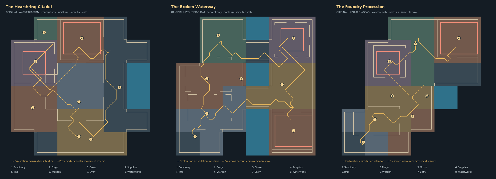

# Spatial and artistic comparison

| Criterion | A — Hearthring Citadel | B — Broken Waterway | C — Foundry Procession |
|---|---|---|---|
| Identity | Restored fortified institution; central cross court and perimeter ring | Damaged works with two banks, interrupted masonry and a water spine | Bent industrial journey from refuge to the inner foundry |
| Exploration | Four gates offer short outward trips and easy return | Two crossings create route choice, different return views and destinations at opposite ends | Preparation branches interrupt a clear forward route; fewer broad detours |
| Orientation | Strongest refuge; north foundry anchors the main axis | Canal and wheel orient the player, but the far-bank return needs careful signage | Strongest successive thresholds; fewer competing landmarks |
| Resource relationship | Workshop west, fishing east, grove northwest around a common refuge | Workshop/grove west, provisions and encounters east; water links industrial purpose | Workshop and cooking sit off the early spine, grove precedes final approach |
| Encounter staging | Imp northwest; Warden remains north centre | Imp northeast, Warden southeast; final furnaces face north toward arrival | Imp west of upper spine; Warden finishes the northeast turn |
| Artistic strength | Masonry rhythm and sanctuary silhouette | Most distinctive silhouette and environmental narrative | Best compression and framed final reveal |
| Artistic weakness | Central court and ring still feel spacious; closest to the existing facility | Ruin dressing is sparse and needs more specific collapse logic; crossings are broad causeways | Some large terrain patches remain; can become a linear activity checklist |
| Implementation | Preserve Warden bounds, but still remap services, Imp, scenery and recovery | Largest anchor remap and strongest need to prove returns/entry orientation in native play | Compact footprint simplifies extent, but both arenas and all safe destinations move |

The shared native-library materials reveal authentic cracked paving, modest low walls, industrial fixtures and stepped chunk edges. They establish plausible asset compatibility, not finished professional dungeon art. Roofed interiors, richer ruin transitions and encounter occupation are not represented. None earns an overall Jagex-quality acceptance claim from this review.

## Recommendation and alternatives

Recommend **B** because its two-bank structure makes the waterworks the floor's organizing cause rather than a side attraction. Returning across a different crossing can reveal the same refuge and foundry from a new direction. Separating encounter destinations gives the player a stronger spatial story than two adjacent northern courts. This is a design judgment, not a measured pacing advantage.

Choose A if sanctuary clarity and repeat visits should dominate. Choose C if a concise first adventure with a strong forward sequence is the priority. A's refuge rhythm or C's thresholds could inform a revised B only if requested; no hybrid is silently selected.

B's water disappears beneath two dry causeways. There is no rendered bridge underpass, flowing-water simulation or navigable lower level. C has no stairs. Those limitations avoid presenting inaccessible or unimplemented verticality as a feature.

## Static measurements, not playtime

| Candidate | Loaded tiles | Reached dry tiles | Real water tiles | Sampled hazard escapes | Issues |
| A | 2048 | 1648 | 128 | 1512 | 0 |
| B | 2112 | 1492 | 256 | 1512 | 0 |
| C | 1600 | 1282 | 64 | 1512 | 0 |

Loaded counts include protected perimeter/seam tiles, blocked water and scenery; reached counts describe the main accessible component. The illustrated tour is one possible path, not a required progression gate. No inferred minutes of gameplay are supplied. Proper pacing, sightlines with actors, native camera obstruction and restoration-state readability remain future acceptance work after selection.
