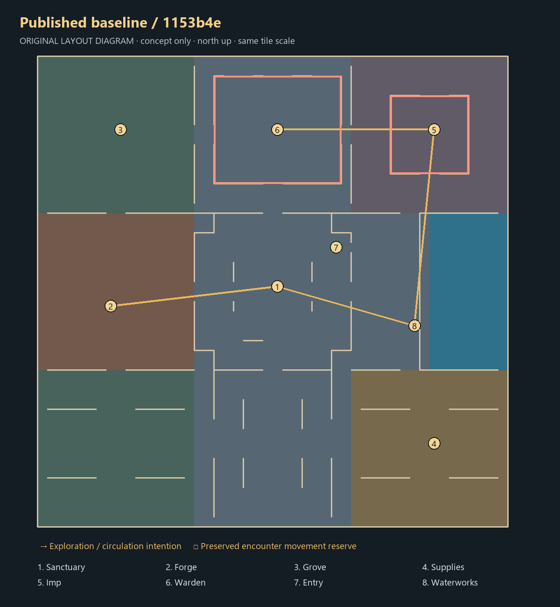

# Current layout audit

Baseline: `1153b4e7281435e83f60bff5131b4a3f0a8e0023`, verified as local HEAD and remote `agent5/tower-development` before design work. It includes the accepted functional implementation and later art receipts. This review changes only offline tools and review files.

The existing 36-chunk floor occupies a full 48×48 tile square. The central sanctuary joins a southern arrival avenue, western mining/smithing yard, northwestern grove, northeastern Imp court, north-central Warden court and eastern fishing quay. Real guarded water and wheel establish a useful regional landmark. Bank, altar, chest and recovery are close to the central refuge. Both boss courts retain deliberate movement reserves.

Its principal weakness is spatial hierarchy: a complete square divided into resource rectangles encourages a facility checklist. Both encounters sit along the same northern edge, while a wide central/southern circulation area has relatively little discovery. Many rooms are legible from a single overview, reducing anticipation. These are design judgments from the source and offline views, not measured player dissatisfaction or proof of bad gameplay pacing.

The proposals challenge the footprint itself: A removes four chunks and builds around a central cross court; B removes three and splits orientation across a canal; C removes eleven and makes the adventure follow a bent sequence. They retain required types of activity without inheriting every prototype coordinate.

The baseline diagram is a geometric illustration, not fresh collision evidence. Local baseline renders use the current cold authored shell exported before this task. Proposed scenes show illustrative hearth/foundry dressing, so they are not matched personal-progression before/after captures. Compare layout, boundaries and sightlines, not restoration state.

Authoritative sources: [template and containment](../../../../crates/world/src/tower_layout.rs), [prepared objects and NPCs](../../../../crates/server/src/tower_map.rs), [personal scenery anchors](../../../../crates/world/src/tower_scenery.rs), [encounter bounds](../../../../crates/world/src/cinderworks_encounter.rs), [prior implementation receipt](../../WATERLINE_ART_AND_LIFECYCLE_20261017.json). No production file was changed to make these candidates pass.
