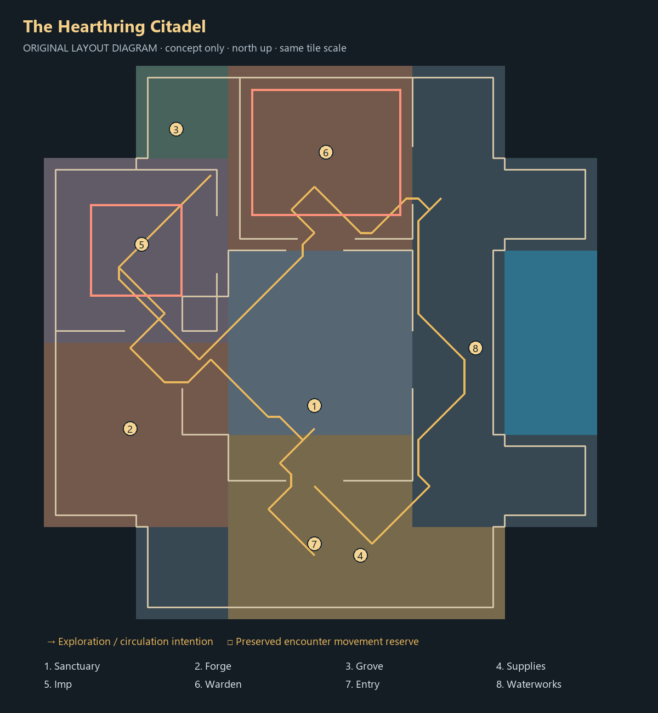

# A — The Hearthring Citadel

**Offline proposal only. Not selected or installed.** [Compare all candidates](../CURRENT_REVIEW.md).

## Journey and circulation

Enter from the south and arrive at a sheltered cross court. Four gates make the refuge a recognizable return point. Walk west into the workshop, continue toward the northwest grove and Imp yard, then approach the north foundry; the eastern fishing quay completes a loop back to preparation.

The gold line is one sampled tour computed through actual clipped geometry. It is not an enforced order or a progression rule. Numbered regions identify functional reserves; red court outlines preserve movement space. Material blocks are schematic and follow authentic source-chunk assignments.

## Environment and staging

The sanctuary reads as the repaired heart of an older fortress. Repeated masonry and paired thresholds connect room edges; water and grove contrast with the soot court. The surrounding loop is intentional circulation rather than a new activity system.

Local renders include consistent overview/reverse/plan cameras plus sanctuary, waterworks and Warden approach. See the local gallery described in the main review. The diagram contains no cache imagery. Actor positions are metadata; creatures, interfaces, live flames and hazard graphics are not rendered.

## Anchors that must be reconfigured after approval

All coordinates are local tile pairs, plane 0; court maxima are inclusive.

| Anchor | Proposed position / bounds |
|---|---|
| hub | `[55, 54]` |
| workshop | `[39, 48]` |
| grove | `[43, 74]` |
| provisions | `[59, 37]` |
| bank | `[48, 55]` |
| altar | `[60, 49]` |
| chest | `[51, 48]` |
| portal | `[55, 40]` |
| wheel | `[72, 58]` |
| fishing | `[[72, 50], [72, 52], [72, 54], [72, 56]]` |
| range | `[67, 52]` |
| recovery | `[55, 50]` |
| entry | `[55, 38]` |
| Imp court (inclusive) | `([36, 60], [43, 67])` |
| Imp spawn | `[40, 64]` |
| Imp approach | `[42, 58]` |
| Warden court (inclusive) | `([50, 67], [62, 77])` |
| Warden spawn | `[56, 72]` |
| Warden approach | `[56, 65]` |
| Warden coolant | `[(53, 71), (53, 74), (60, 71), (60, 74)]` |

The JSON is the authoritative composition source. The workshop expands into ore, anvil and furnace offsets in the isolated compiler; three grove trees remain visual reserves. Provision regions reserve space for real actor populations, not newly implemented livestock or progression.

Production adoption requires coordinated changes to `tower_layout` chunk template; `tower_map` removals, placements and NPC rows; `tower_cinderworks` services; encounter bounds/spawns; `tower_scenery` vents, boiler, coolant and restoration pairs; `tower_scene` reset/quiet-arena mapping; rescue destination alternatives, arrival/login and saved-position migration. Entry, exit, plaque, bank, altar, chest, range and all resource approaches must be revalidated. Existing first-clear, reward, personal restoration and persistence rules stay authoritative.

## Risks and acceptance still required

The ring can feel too empty and orderly. Tighten secondary court edges and prove which detours are worth taking before detailed dressing. Warden bounds stay at the baseline position, but its approach and surrounding scenery still change.

Static audit: 2048 loaded tiles, 1648 reached dry tiles, 128 blocked water tiles; 1,512 hazard escapes and zero reported issues. The sampled illustration totals 119 normal movement steps; this is not measured session pacing. Recheck actual actors, all vent/coolant interactions, rescue alternatives, camera visibility, normal progression, reconstruction and save/relogin behavior only after a direction is chosen. Static passing does not authorize installation.
