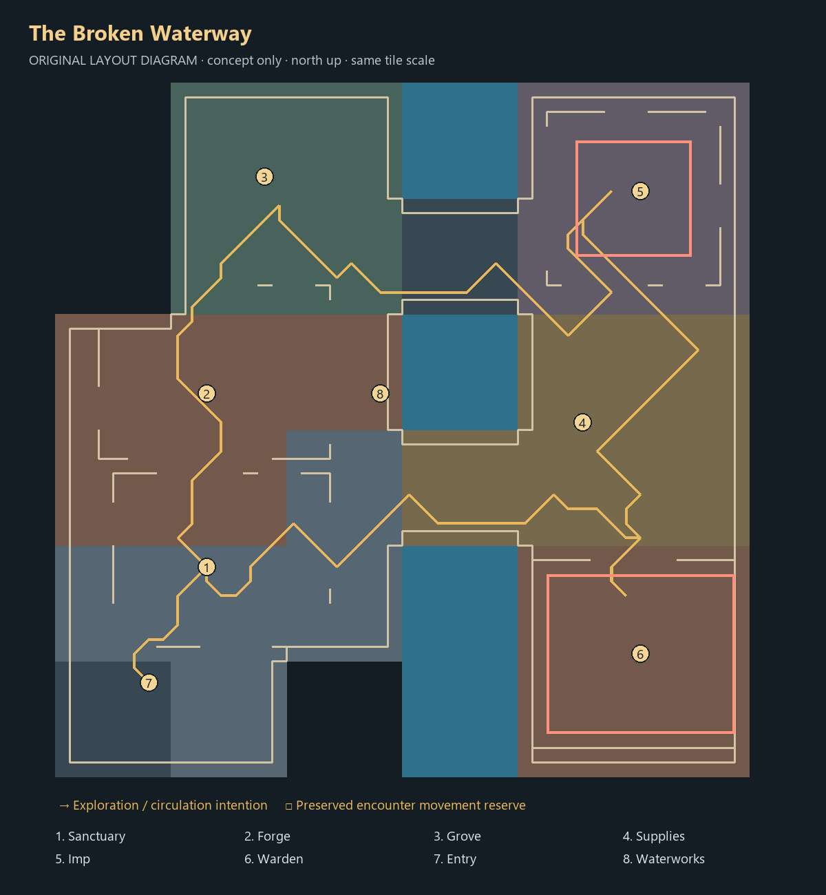

# B — The Broken Waterway

**Offline proposal only. Not selected or installed.** [Compare all candidates](../CURRENT_REVIEW.md).

## Journey and circulation

Enter the southwest ruined refuge. Work the western forge and take either of two dry causeways across the canal. The northeast Imp court and southeast Warden court pull exploration in opposing directions. The northern grove and detached altar create a quieter return path above the workshop.

The gold line is one sampled tour computed through actual clipped geometry. It is not an enforced order or a progression rule. Numbered regions identify functional reserves; red court outlines preserve movement space. Material blocks are schematic and follow authentic source-chunk assignments.

## Environment and staging

Broken wall lines, six controlled rubble clusters and a central water cut suggest a works whose industrial system outlived its buildings. The wheel sits against real water. Two broad crossings connect dry banks; they do not render an underpass or working hydraulic simulation.

Local renders include consistent overview/reverse/plan cameras plus sanctuary, waterworks and Warden approach. See the local gallery described in the main review. The diagram contains no cache imagery. Actor positions are metadata; creatures, interfaces, live flames and hazard graphics are not rendered.

## Anchors that must be reconfigured after approval

All coordinates are local tile pairs, plane 0; court maxima are inclusive.

| Anchor | Proposed position / bounds |
|---|---|
| hub | `[43, 46]` |
| workshop | `[42, 58]` |
| grove | `[46, 73]` |
| provisions | `[68, 56]` |
| bank | `[38, 47]` |
| altar | `[51, 68]` |
| chest | `[45, 43]` |
| portal | `[38, 35]` |
| wheel | `[56, 58]` |
| fishing | `[[56, 57], [56, 59], [56, 61], [56, 62]]` |
| range | `[51, 55]` |
| recovery | `[42, 46]` |
| entry | `[38, 38]` |
| Imp court (inclusive) | `([68, 68], [75, 75])` |
| Imp spawn | `[72, 72]` |
| Imp approach | `[70, 65]` |
| Warden court (inclusive) | `([66, 35], [78, 45])` |
| Warden spawn | `[72, 40]` |
| Warden approach | `[71, 48]` |
| Warden coolant | `[(69, 39), (69, 42), (76, 39), (76, 42)]` |

The JSON is the authoritative composition source. The workshop expands into ore, anvil and furnace offsets in the isolated compiler; three grove trees remain visual reserves. Provision regions reserve space for real actor populations, not newly implemented livestock or progression.

Production adoption requires coordinated changes to `tower_layout` chunk template; `tower_map` removals, placements and NPC rows; `tower_cinderworks` services; encounter bounds/spawns; `tower_scenery` vents, boiler, coolant and restoration pairs; `tower_scene` reset/quiet-arena mapping; rescue destination alternatives, arrival/login and saved-position migration. Entry, exit, plaque, bank, altar, chest, range and all resource approaches must be revalidated. Existing first-clear, reward, personal restoration and persistence rules stay authoritative.

## Risks and acceptance still required

The two crossings risk repetitive travel. Native play must test the benefit of a second return route, sightlines from each bank and the refuge-to-altar distance. The south Warden battery was turned toward arrival after the first render exposed furnace backs.

Static audit: 2112 loaded tiles, 1492 reached dry tiles, 256 blocked water tiles; 1,512 hazard escapes and zero reported issues. The sampled illustration totals 129 normal movement steps; this is not measured session pacing. Recheck actual actors, all vent/coolant interactions, rescue alternatives, camera visibility, normal progression, reconstruction and save/relogin behavior only after a direction is chosen. Static passing does not authorize installation.
