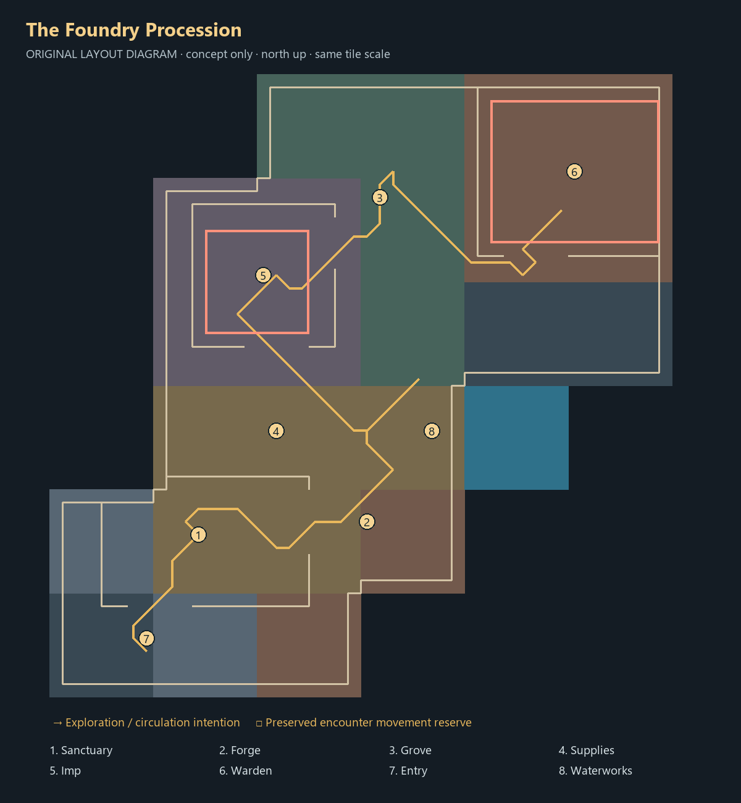

# C — The Foundry Procession

**Offline proposal only. Not selected or installed.** [Compare all candidates](../CURRENT_REVIEW.md).

## Journey and circulation

Start in a southwest refuge, move east through preparation and the wheel court, then bend north toward an Imp branch. Continue past the grove and turn east through the framed Warden approach. Provisions stay close to the early workshop rather than on a remote late-game spur.

The gold line is one sampled tour computed through actual clipped geometry. It is not an enforced order or a progression rule. Numbered regions identify functional reserves; red court outlines preserve movement space. Material blocks are schematic and follow authentic source-chunk assignments.

## Environment and staging

The sense of ascent comes from successive thresholds and the final turn into a larger foundry, entirely on plane zero. Short side branches preserve choice without sprawling into a full square; low walls frame future destinations.

Local renders include consistent overview/reverse/plan cameras plus sanctuary, waterworks and Warden approach. See the local gallery described in the main review. The diagram contains no cache imagery. Actor positions are metadata; creatures, interfaces, live flames and hazard graphics are not rendered.

## Anchors that must be reconfigured after approval

All coordinates are local tile pairs, plane 0; court maxima are inclusive.

| Anchor | Proposed position / bounds |
|---|---|
| hub | `[44, 44]` |
| workshop | `[56, 45]` |
| grove | `[57, 70]` |
| provisions | `[49, 52]` |
| bank | `[39, 45]` |
| altar | `[48, 40]` |
| chest | `[44, 40]` |
| portal | `[39, 34]` |
| wheel | `[64, 50]` |
| fishing | `[[64, 49], [64, 51], [64, 53], [64, 54]]` |
| range | `[59, 51]` |
| recovery | `[43, 44]` |
| entry | `[39, 36]` |
| Imp court (inclusive) | `([44, 60], [51, 67])` |
| Imp spawn | `[48, 64]` |
| Imp approach | `[49, 58]` |
| Warden court (inclusive) | `([66, 67], [78, 77])` |
| Warden spawn | `[72, 72]` |
| Warden approach | `[69, 65]` |
| Warden coolant | `[(69, 71), (69, 74), (76, 71), (76, 74)]` |

The JSON is the authoritative composition source. The workshop expands into ore, anvil and furnace offsets in the isolated compiler; three grove trees remain visual reserves. Provision regions reserve space for real actor populations, not newly implemented livestock or progression.

Production adoption requires coordinated changes to `tower_layout` chunk template; `tower_map` removals, placements and NPC rows; `tower_cinderworks` services; encounter bounds/spawns; `tower_scenery` vents, boiler, coolant and restoration pairs; `tower_scene` reset/quiet-arena mapping; rescue destination alternatives, arrival/login and saved-position migration. Entry, exit, plaque, bank, altar, chest, range and all resource approaches must be revalidated. Existing first-clear, reward, personal restoration and persistence rules stay authoritative.

## Risks and acceptance still required

The clear spine can become a checklist, and narrower branches leave less room for later activity. It needs optional discoveries within the same compact structure. There is no literal stair or elevated route; none is claimed.

Static audit: 1600 loaded tiles, 1282 reached dry tiles, 64 blocked water tiles; 1,512 hazard escapes and zero reported issues. The sampled illustration totals 78 normal movement steps; this is not measured session pacing. Recheck actual actors, all vent/coolant interactions, rescue alternatives, camera visibility, normal progression, reconstruction and save/relogin behavior only after a direction is chosen. Static passing does not authorize installation.
